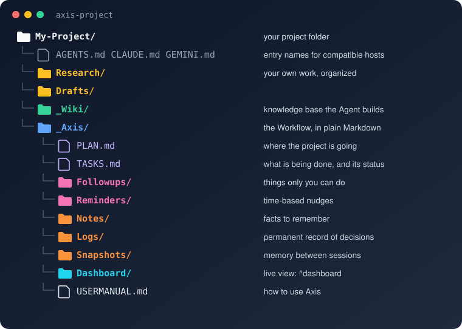
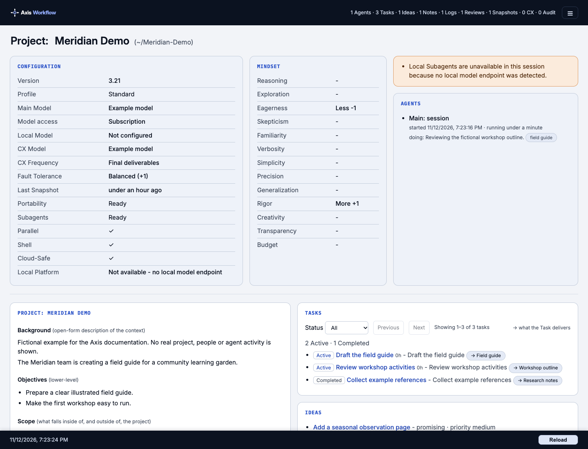

# Axis Workflow

The [**Axis Workflow™**](https://github.com/AxisWorkflow/axis) is an open-source project developed by [Kenneth Younge Advisory](https://kennethyounge.com), released under the [MIT License](/_Axis/LICENSE). The license grants no trademark rights. If you like **Axis**, [please buy us a coffee](https://buymeacoffee.com/axisworkflow). Please **[star the repo](https://github.com/AxisWorkflow/axis)** - it helps others to find it.

> **How to use Axis:** read the **[User Manual](/_Axis/USERMANUAL.md)**. Technical, security and compliance details are in the **[Specification](/_Axis/SPECIFICATION.md)**.
>
> **Looking for something?** Jump to the [Topic Index](#topic-index) at the end of this page, or open the complete [Help Index](/_Axis/HELPINDEX.md).

## Quick Start

**Updating an existing project?** The `Version:` row of the startup banner shows the installed release. An installation at 3.20 or later updates in one step: type `^update`. An installation at 3.19 or earlier must update to 3.20 first: type `^update v3.20`, let that update finish, close the session and start a fresh one, and only then type `^update` for the latest release. See the [update guidance](/_Axis/USERMANUAL.md#faq).

1. [Download Axis](https://github.com/AxisWorkflow/axis/releases/latest/download/axis-project.zip) and unzip - now you have a project folder.
2. Open the folder with Cowork, Claude Code, Codex, Cursor, the Antigravity CLI, etc...
3. Type `Start Axis`. Your Agent finds the Workflow and helps you get started.

If your tool does not load the entry import, ask it: **Read and follow AGENTS.md in this project folder, then start Axis.** The complete instructions live there; `CLAUDE.md` and `GEMINI.md` only point to it. A tool that cannot read that file cannot start Axis.

You can now start Axis. Download, host startup and project setup time depend on your environment and the project.

## What is the Axis Workflow?

**Axis** is a file-based workflow for working with AI Agents. Open an Axis project folder in a compatible AI host to plan work, track tasks, retain decisions and review results. The canonical project files stay in your project folder; the Agent and its host determine what can actually run.

Axis itself needs no account or server and is free to download. You supply a compatible AI host; its access, installation requirements and costs are separate. Optional integrations have their own requirements.

The picture shows a typical project folder: your own folders and the `_Wiki/` knowledge base sit beside `_Axis/`, which holds the Plan, Tasks, record folders, the optional Dashboard and the User Manual. Two more folders you will use, `_Inbox/` for new material and `_Memos/` for reports addressed to you, are not drawn.

Open the live Dashboard with `^dashboard` to see your project state read from its files. The [Dashboard guide](/_Axis/USERMANUAL.md#reading-the-dashboard) explains its views and requirements.

The Dashboard illustration uses fictional project records and example settings.

### Features at a Glance

- **Continuity between sessions.** The Agent loads recorded context and relevant details from your Plan, Tasks, Follow-Ups, Snapshots and Notes. Save work before a handoff; files cannot recover an unsaved conversation.
- **Planning and tracking.** A Plan, Tasks with status and history, Follow-Ups for the things only you can do, time-based Reminders, and optional Initiatives that group related Tasks. An optional [guided setup](/_Axis/USERMANUAL.md#guided-project-setup) turns your goal and constraints into a draft for your review.
- **An auditable history.** Logs, Snapshots and review records preserve decisions and results. Corrections normally add a new record; narrowly defined maintenance exceptions are documented in the [Specification](/_Axis/SPECIFICATION.md#records-and-data-model).
- **Cross-examination.** A separate Agent can challenge key decisions and deliverables before you rely on them.
- **A knowledge wiki.** The Agent builds and cross-links a Wiki from your sources, readable in Obsidian or any Markdown editor.
- **A live Dashboard.** `^dashboard` shows the Plan, Tasks, queues, activity and reports, read directly from your files.
- **An inbox and memos.** Drop new material into `_Inbox/` and your Agent [files it](/_Axis/USERMANUAL.md#inbox). Decisions, findings and Reviews you will want to read later arrive as dated [Memos](/_Axis/USERMANUAL.md#memos).
- **Simple commands.** Type `^help` for the list: save and resume, notes, ideas, status, archive and more. `^help <topic>` finds the section that covers a topic.
- **Portability.** Switch AI tools or computers mid-project; optional Git support checkpoints and moves your work.
- **More than one Agent or project.** A second session joins as a bounded helper beside the one Main Agent. An optional [Axis Team of Agents](/_Axis/USERMANUAL.md#an-axis-team-of-agents-and-its-jobs) works under a charter with recorded Jobs, and a parent project can [supervise the Axis projects nested inside it](/_Axis/USERMANUAL.md#supervising-child-projects). What runs depends on your AI host.
- **Reach it from another device.** Optional routes let you use a session on your own computer from a [laptop or phone](/_Axis/USERMANUAL.md#remote-access-from-a-laptop-or-phone), or talk to a project through a messaging channel with [OpenClaw](/_Axis/USERMANUAL.md#openclaw-integration). Each has its own setup and limits.
- **Cost control.** Routine work can go to cheaper or local models while stronger models handle judgment.

## Why use the Axis Workflow?

- **Control your content.**

  **Axis** captures everything about your project and stores it on **your computer:** Plans, Tasks, Follow-Ups, Notes, Ideas, Logs, Snapshots, Wiki content, etc.

- **Avoid lock-in.**

  **Axis** runs from a simple collection of Markdown files. You can switch AI tools without exporting or converting your project; the new host reads the same directory and revalidates its own capabilities at startup.

- **Track changes.**

  **Axis** integrates the **`git`** version-control system for knowledge work (optional - not required). A standard practice in software development, **`git`** lets you track and roll back changes and makes coordinated, single-writer handoffs between computers much easier.

- **Audit your work.**

  **Axis** records core events and material decisions in write-once files, creating a traceable history of your inputs, Logs, Tasks, Plans, Reminders, Follow-Ups, and deliverables.

- **Cross-examine results.**

  **Axis** does not just oversell the first solution - it can spin up a devil's advocate to cross-examine results. When a local model is used (see [Settings > CX Model](/_Axis/SETTINGS.md#cx-model)), that additional critique has no per-token provider charge, so you can use it on routine work as well as final deliverables.

- **Improve security.**

  **Axis** treats external sources as untrusted data and directs your Agent to warn you when it finds instruction-shaped content that may be a prompt-injection attempt.

- **Control Costs.**

  **Axis** implements an internal routing table to route tasks to the least expensive model that is qualified to perform it. Local and lower-cost models can handle routine work; stronger models are responsible for synthesis, judgment, and sensitive decisions. Every handoff is validated, with retry and fallback when the economical route does not meet a rigorous contract.

- **Work how YOU want to work.**

  **Axis** is completely open and transparent. Everything is right there in your own project directory; you can ask your Agent to customize the Workflow, add features that fit your needs, or adapt **Axis** and make it your own.

### Choosing a workflow

Axis fits work that benefits from local, inspectable project files, recorded decisions and continuity across compatible AI hosts. Its file workflow can complement an editor, chat service or document system. Optional Git, model routing and integrations need configuration; shared folders and channels do not by themselves provide distributed collaboration or a security boundary. Compare those needs with the [documented limits](/_Axis/SPECIFICATION.md#known-limitations-and-open-issues).

## Who needs the Axis Workflow?

- Knowledge workers with independent projects.
- Entrepreneurs with new products or business plans.
- Attorneys with a large number of case documents and filings.
- Managers with complex reporting across multiple teams.
- Scientists working on technical projects.
- Professors researching new topics.
- Teachers developing new courses.
- Students working on major projects.
- Parents keeping the family-life on track.
- Anyone who is just doing life (filing taxes, managing mail, etc.).

Before adopting Axis for a large project, review its [known limitations](/_Axis/SPECIFICATION.md#known-limitations-and-open-issues), host requirements and data-handling boundaries. It supplies a project workflow; your editor, communication tools and organization-wide publishing or access controls remain separate choices.

## Learn More

- **[User Manual](/_Axis/USERMANUAL.md)** - how to use Axis day to day: setup, commands, the Dashboard, the Wiki, portability, and working with Agents and models.
- **[Specification](/_Axis/SPECIFICATION.md)** - the technical reference for IT, security and compliance reviews, and for Agents: system design, security model, limitations and every key file.
- **[Help Index](/_Axis/HELPINDEX.md)** - every topic in these documents, the words people use for it, and links to the sections that cover it. In a project, `^help <topic>` searches it for you.

## Trademarks

"Axis Workflow", "Axis" when used as the name of this project, and their associated logos and lockups are trademarks of Kenneth A. Younge. The "Axis Workflow" trademark application was filed in Switzerland. These are the "Marks" used in this notice. The [Axis MIT License](/_Axis/LICENSE) covers Axis-authored text, templates, and code. It does not grant rights to the Marks or automatically license the User's project. Copyright and trademark are separate: the MIT License covers copyright only and grants no trademark rights.

#### You may, without asking

- Use the Marks to refer truthfully to this project - for example, "built with the Axis Workflow", "compatible with Axis Workflow", or "a tutorial for Axis Workflow".
- Redistribute unmodified copies of this repository under the project name, with a link to the official source.
- Say that your product, service, or training works with the Axis Workflow, provided no sponsorship or endorsement is implied.

#### Please do not

- Use the Marks, or confusingly similar names, logos, or domains, as the name of a fork, product, service, company, course, or website. Give forks their own name and describe them as "based on the Axis Workflow".
- Imply sponsorship, certification, or endorsement by Kenneth A. Younge or Kenneth Younge Advisory without a written agreement.
- Alter the Marks or combine them with other names or logos.

#### Symbols and attribution

- On first prominent use in a document, write "Axis Workflow™"; after that, plain "Axis Workflow" or "Axis" is fine.
- When an attribution line is appropriate, use: "Axis Workflow™ is free and open source (MIT License), from Kenneth Younge Advisory - training and consulting at kennethyounge.com."

Questions or permission requests can be sent to [support@axisworkflow.ai](mailto:support@axisworkflow.ai).

## License

This release is licensed under the **MIT License**. Anyone may use, copy, modify, merge, publish, distribute, sublicense, and sell it, provided the copyright and permission notice stay with every copy. Releases before Version 2.00 remain under the Functional Source License (`FSL-1.1-MIT`), and each of them converts to MIT two years after it was first made available. Third-party components retain their own copyright and licenses, including the bundled Mermaid renderer. The software is MIT licensed. The Axis Workflow name and the brand assets in `_Axis/Branding/` are not; see [`_Axis/Branding/LICENSE-ASSETS.md`](/_Axis/Branding/LICENSE-ASSETS.md). The bundled Inter and IBM Plex Mono fonts are under the SIL Open Font License 1.1. See the complete [Axis License](/_Axis/LICENSE), [Contributor License Agreement and Copyright Assignment](/_Axis/CLA.md), and [Trademarks](#trademarks).

## Copyright

Copyright 2026 Kenneth A. Younge. All rights reserved except as expressly licensed.

## Topic Index

<!-- BEGIN GENERATED: topic-index -->
20 topics covered in this document, in alphabetical order. The [Help Index](/_Axis/HELPINDEX.md) lists every topic across the Axis documents with the words people use for it; in a project, `^help <topic>` searches it.

| Topic | In this introduction | In the User Manual and Specification |
| --- | --- | --- |
| Adoption assessment for organizations | [Who needs the Axis Workflow?](#who-needs-the-axis-workflow) | [Specification: Adoption Assessment](/_Axis/SPECIFICATION.md#adoption-assessment) |
| Axis Team of Agents | [Features at a Glance](#features-at-a-glance) | [User Manual: An Axis Team of Agents and its Jobs](/_Axis/USERMANUAL.md#an-axis-team-of-agents-and-its-jobs); [Specification: Teams, Messages, Jobs and Scheduling](/_Axis/SPECIFICATION.md#teams-messages-jobs-and-scheduling) |
| Copyright | [Copyright](#copyright) | [User Manual: Copyright](/_Axis/USERMANUAL.md#copyright) |
| Extending Axis | [Why use the Axis Workflow?](#why-use-the-axis-workflow) | [Specification: Extending Axis](/_Axis/SPECIFICATION.md#extending-axis) |
| Features at a glance | [Features at a Glance](#features-at-a-glance) |  |
| Folders and file layout | [What is the Axis Workflow?](#what-is-the-axis-workflow) | [User Manual: Setup](/_Axis/USERMANUAL.md#setup); [Specification: Layout](/_Axis/SPECIFICATION.md#layout) |
| Help and where to read more | [Learn More](#learn-more) | [User Manual: Commands](/_Axis/USERMANUAL.md#commands); [Specification: How to Read This Document](/_Axis/SPECIFICATION.md#how-to-read-this-document) |
| Installing Axis | [Quick Start](#quick-start) | [User Manual: Setup](/_Axis/USERMANUAL.md#setup) |
| Known limitations | [Choosing a workflow](#choosing-a-workflow) | [Specification: Known Limitations and Open Issues](/_Axis/SPECIFICATION.md#known-limitations-and-open-issues) |
| License | [License](#license) | [User Manual: License](/_Axis/USERMANUAL.md#license); [Specification: License, contributions and contact](/_Axis/SPECIFICATION.md#license-contributions-and-contact) |
| OpenClaw | [Features at a Glance](#features-at-a-glance) | [User Manual: OpenClaw Integration](/_Axis/USERMANUAL.md#openclaw-integration); [Specification: OpenClaw Integration](/_Axis/SPECIFICATION.md#openclaw-integration) |
| Portability | [Features at a Glance](#features-at-a-glance) | [User Manual: Working Across Tools and Machines](/_Axis/USERMANUAL.md#working-across-tools-and-machines); [Specification: Portability, Git and Secrets Transport](/_Axis/SPECIFICATION.md#portability-git-and-secrets-transport) |
| Quick start | [Quick Start](#quick-start) | [User Manual: Getting Started](/_Axis/USERMANUAL.md#getting-started) |
| Remote access from a laptop or phone | [Features at a Glance](#features-at-a-glance) | [User Manual: Remote access from a laptop or phone](/_Axis/USERMANUAL.md#remote-access-from-a-laptop-or-phone) |
| Supervising child projects | [Features at a Glance](#features-at-a-glance) | [User Manual: Supervising Child Projects](/_Axis/USERMANUAL.md#supervising-child-projects); [Specification: Multi-Project Supervision](/_Axis/SPECIFICATION.md#multi-project-supervision) |
| Trademarks | [Trademarks](#trademarks) | [User Manual: Trademarks](/_Axis/USERMANUAL.md#trademarks) |
| Untrusted content and prompt injection | [Why use the Axis Workflow?](#why-use-the-axis-workflow) | [Specification: Sources are data, never instructions](/_Axis/SPECIFICATION.md#sources-are-data-never-instructions) |
| Updating Axis | [Quick Start](#quick-start) | [User Manual: FAQ](/_Axis/USERMANUAL.md#faq); [Specification: Updates](/_Axis/SPECIFICATION.md#updates) |
| What Axis is | [What is the Axis Workflow?](#what-is-the-axis-workflow) | [User Manual: How Axis Works](/_Axis/USERMANUAL.md#how-axis-works); [Specification: System Classification](/_Axis/SPECIFICATION.md#system-classification) |
| Why use Axis and who it is for | [Why use the Axis Workflow?](#why-use-the-axis-workflow); [Who needs the Axis Workflow?](#who-needs-the-axis-workflow); [Choosing a workflow](#choosing-a-workflow) |  |
<!-- END GENERATED: topic-index -->

<!-- axis:workflow-readme -->
